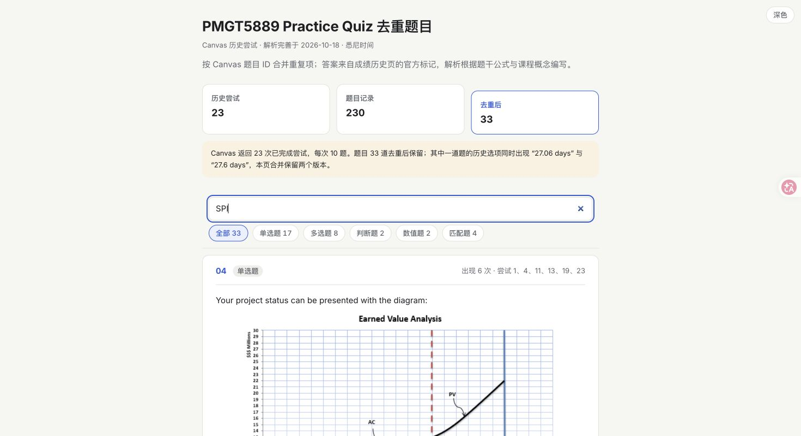
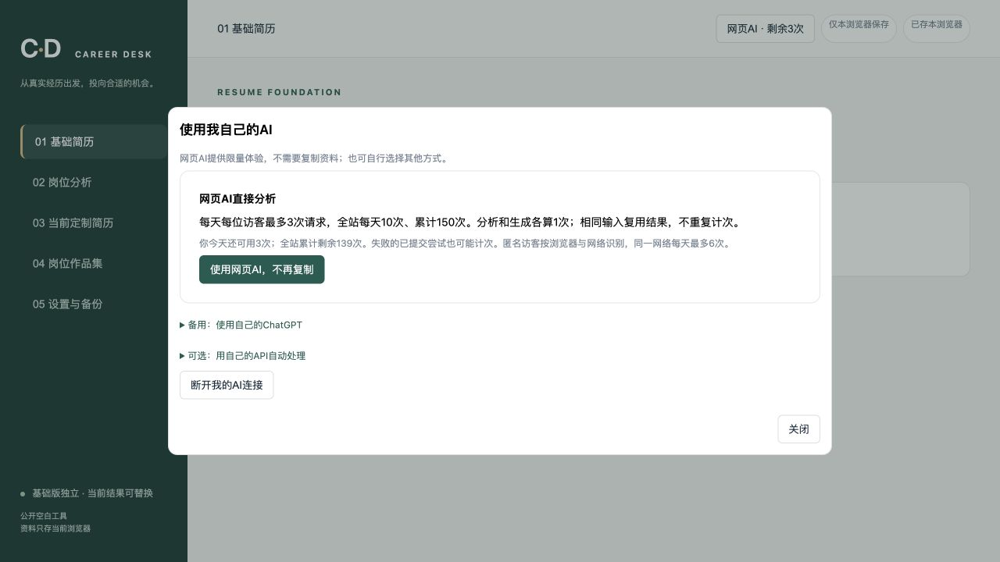

# AI 辅助个人项目作品集

这里展示我从个人学习和求职需求出发，通过 AI 辅助完成的两个独立网页项目。我负责提供资料、明确需求、核对内容、测试使用流程并反馈修改；AI 辅助整理资料、编写与调试代码。

本仓库用于作品展示，包含项目说明、界面截图和在线体验链接，不是完整源码仓库，也不包含私人简历、API 密钥或原始学习记录。

## 在线体验

- [作品一：课程题库网页](https://pmgt5889-practice-quiz-2026.awakepoppy6.chatgpt.site/)
- [作品二：Career Desk 求职辅助工具](https://career-desk-clean.awakepoppy6.chatgpt.site/)

两个作品均为 AI 辅助个人项目，不是正式实习、团队商业项目或学校官方产品。AI 体验服务有使用限额，以网页中的提示为准。

## 作品一 课程题库网页

### 问题与使用场景

课程练习题分散在多次历史记录中，同一题目会重复出现，复习时需要反复翻查题目、答案和解析。我希望把这些内容集中到一个能够检索的页面。

### 我的行动与分工

- 提供题目与历史记录，明确去重、集中展示和关键词检索的需求。
- 核对整理后的题目与答案，检查解析内容，并反馈需要修正的地方。
- 根据实际复习过程检查网页是否方便查找和阅读。
- AI 辅助整理资料、编写网页代码和解析初稿；解析仍需人工核对。

### 当前产出与验证

- 形成可在线访问的题库网页，集中展示题目、答案及解析。
- 支持关键词检索，以及单选、多选、判断、数值和匹配等题型筛选。
- 在发布本作品说明时，实际检查了页面访问、题型筛选和关键词检索。当前页面展示 33 道去重题目；这只是资料规模，不是学习效果或效率提升指标。

[打开课程题库网页](https://pmgt5889-practice-quiz-2026.awakepoppy6.chatgpt.site/)

### 局限与后续改进

目前服务于特定课程的个人复习场景，不代表已验证适用于其他课程；未进行学习效果评估。课程资料的公开使用应遵守相关授权与要求，本仓库不另行分发完整题库、课程附件或 Canvas 原始记录。

## 作品二 Career Desk 求职辅助工具

### 问题与使用场景

面对不同岗位，需要反复比较 JD 与个人经历、调整简历表达并导出文件。我希望先判断岗位是否值得投递，再基于同一份基础简历生成当前岗位的定制版本，避免沿用上一岗位的修改。

### 我的行动与分工

- 明确“上传基础简历 → 输入 JD → 分析匹配 → 主动生成 → 预览 → 下载 Word”的使用流程。
- 要求基础版本与定制结果分开；切换岗位时重新从基础版本出发，不自动建立简历版本库。
- 在实际使用中提出并反馈问题，包括复制资料到 ChatGPT 的步骤、刷新后重复分析、头像遮挡文字和公开体验成本控制。
- 确认隐私边界与展示范围，要求不预载个人资料、密钥仅留后端、公开体验限次。
- AI 辅助进行功能实现、代码修改与技术验证；我不将其描述为独立编程开发。

### 当前产出与验证

- 支持上传 DOCX 或文字型 PDF 作为基础简历，输入 JD 文字或截图进行真实 AI 分析。
- 分析后由使用者决定是否生成定制简历，展示当前结果和简短修改说明。
- 有原始 DOCX 时，在原文件基础上修改文字并导出可继续编辑的 Word；不把整页图片当成可编辑 Word。
- 支持当前工作区的浏览器本地保存、备份恢复，以及已有作品集文件的分类与下载管理。
- 已进行合成资料的真实 AI 分析、Word 下载和渲染检查，以及岗位切换隔离、重复输入复用、限额等测试；这些是功能验证，不代表大规模用户测试。

[打开 Career Desk](https://career-desk-clean.awakepoppy6.chatgpt.site/)

### 局限与后续改进

AI 输出仍需核对，匹配分不代表录用概率。复杂 Word 模板、字体缺失和分页可能导致网页预览与本机 Word 不完全一致；只有 PDF 时，不能保证还原成完全同版式的可编辑 Word。当前资料主要保存在使用者自己的浏览器，不是永久云端档案库。尚无经过验证的商业化、用户增长或效率提升数据。

## 体验与隐私说明

1. 请优先使用脱敏资料体验，不要上传无权使用的他人简历或内部资料。
2. Career Desk 的 AI 处理需要联网并主动授权；原始 DOCX/PDF、头像和作品集附件不会默认发给 AI。
3. AI 返回结果会为恢复进度而短期加密暂存；详细规则见[网站隐私说明](https://career-desk-clean.awakepoppy6.chatgpt.site/privacy.html)。
4. 本仓库仅公开项目说明和经过检查的截图，不公开个人资料、后台数据或服务密钥。

